## Chapter 4 - Traffic Control

1. When the road is marked with a solid yellow line and a broken yellow line on your side you may pass:
   - Only in an emergency
   - If you are on an expressway
   - **✔ If traffic is clear**
   - Only at an intersection

2. Which of the following must you obey over the other three?
   - A steady red light
   - **✔ A police officer**
   - A stop sign
   - A flashing red light

3. A traffic light which has a green arrow and a red light means that:
   - You may only drive straight ahead
   - **✔ You may drive only in the direction of the green arrow**
   - You must wait for a green light
   - Vehicles moving in any direction must stop

4. A red and white triangular sign at an intersection means:
   - Look both ways as you cross the intersection
   - **✔ Slow down and be prepared to stop if necessary**
   - Slow down if an emergency vehicle is approaching
   - Always come to a full stop at the intersection

5. A diamond-shaped sign is a:
   - **✔ Road hazard sign**
   - Interstate route site
   - School crossing sign
   - Speed limit sign

6. You come to an intersection which has a flashing red light. You should:
   - **✔ Come to a full stop, then go when safe to do so**
   - Stop only if cars are approaching the intersection
   - Stop only if cars are already in the intersection
   - Slow down and be prepared to stop if necessary

7. Which of the following is used on some highways to direct drivers into the proper lanes for turning?
   - Flashing red lights
   - Flashing yellow lights
   - White lines on the side of the road
   - **✔ White arrows in the middle of the lanes**

8. You may cross a double solid yellow line:
   - To pass a slow moving truck
   - **✔ To turn into a driveway**
   - To pass a car if traffic permits
   - Under no conditions

9. As you near an intersection, the traffic light changes from green to yellow. Your best action would be to:
   - Speed up to beat the red light
   - Apply the brakes sharply to stop
   - Be prepared to stop in the center of the intersection
   - **✔ Be prepared to stop before the intersection**

10. What does this road sign (stop sign) mean? 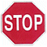
   - Slow down and prepare to stop only if cars are approaching you
   - **✔ Come to a full stop, then go when it is safe to do so**
   - Proceed carefully through the intersection, not always stopping
   - Stop only for traffic on an intersecting road

11. You may not cross a single broken white (or yellow) line:
   - **✔ When to do so would interfere with traffic**
   - When turning left into a driveway
   - When the car in front is disabled
   - When passing to the right on a one-way street

12. A solid white line on the right edge of the highway slants in toward your left. This shows that:
   - There is an intersection just ahead
   - You are approaching a construction area
   - You will be required to turn left just ahead
   - **✔ The road will get narrower**

13. What are the colors of the warning signs that indicate hazards ahead, such as curves in the road or narrow bridges?
   - Black letters or symbols on a white background
   - **✔ Black letters or symbols on a yellow background**
   - White letters or symbols on a blue background
   - White letters or symbols on a green background

14. An intersection has a stop sign and a crosswalk, but no stop line. You must stop:
   - **✔ Before the crosswalk**
   - 50 feet before the intersection
   - Where you think the stop line would be
   - With your front wheels in the crosswalk

15. You may cross a single solid white line in the highway:
   - Whenever you want to
   - **✔ If traffic conditions require**
   - Only to turn into a driveway
   - Only to make a u-turn

16. What does a flashing yellow light mean?
   - Merging traffic
   - **✔ Proceed with caution**
   - Pedestrian crossing
   - Come to a full stop

17. What are the colors of a sign which tells you the distance to the next exit of a highway?
   - Yellow with black letters
   - Black with white letters
   - Red with white letters
   - **✔ Green with white letters**

18. A rectangular-shaped sign is a:
   - Railroad crossing sign
   - Stop sign
   - School crossing sign
   - **✔ Speed limit sign**

## Chapter 5 - Intersections and Turns

1. You are waiting in the intersection to complete a left turn. You should:
   - Signal and keep your wheels turned to the left
   - **✔ Signal and keep your wheels straight**
   - Flash your headlights so the driver will let you through
   - Drive around the rear of a car if it blocks you

2. You want to turn left at an intersection. The light is green but oncoming traffic is heavy. You should:
   - Use the next intersection
   - Wait at the crosswalk for traffic to clear
   - **✔ Wait in the center of the intersection for traffic to clear**
   - Take the right-of-way since you have the light

3. You are making a left turn away from a two-way street into a one-way street. When you have completed the turn your car should be:
   - In the right lane of the street
   - In the center of the street
   - **✔ In the left lane of the street**
   - In the lane with the least traffic

4. When two vehicles enter an intersection from different highways at the same time, which vehicle must yield the right-of-way?
   - Either one
   - **✔ Vehicle on the left**
   - Vehicle on the right
   - Neither one

5. You come to an intersection which is blocked by other traffic. You should:
   - Go slowly until the traffic ahead moves
   - Get as close as possible to the other car
   - **✔ Stay out of the intersection until you can pass through**
   - Sound your horn to make the cars move up

6. You have the right of way when you are:
   - Entering a traffic circle
   - Backing out of a driveway
   - Leaving a parking space
   - **✔ Already in a traffic circle**

7. The driver's left hand and arm are extended upward. This hand signal (left hand up) means that the driver plans to: 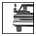
   - Turn left
   - **✔ Turn right**
   - Come to a stop
   - Go straight ahead

8. What should you do when you are going to enter a roadway from a private road?
   - Blow your horn to warn cars you are entering the roadway
   - Stop with part of the car on the roadway to warn other drivers
   - Drive out fast to merge smoothly with the traffic
   - **✔ Yield the right-of-way to pedestrians and roadway traffic**

9. The driver's left arm and hand are extended downward. This hand signal (left hand down) means that the driver plans to: 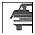
   - Turn left
   - Turn right
   - **✔ Stop**
   - Start up

10. You must yield the right-of-way to an approaching vehicle when you are:
   - Already in a traffic circle
   - Already in an intersection
   - Going straight ahead
   - **✔ Turning left**

11. You must pull over and stop for:
   - Vehicles that display blue, green or amber lights
   - **✔ Authorized emergency vehicles responding to emergencies**
   - A hazard vehicle that is parked, stopped or standing on any part of the highway
   - Stopped or standing school buses

12. You drive along a street and hear a siren. You cannot immediately see the emergency vehicle. You should:
   - Keep driving until you see the vehicle
   - **✔ Pull to the curb and look to see if it is on your street**
   - Slow down but don't stop until you see it
   - Speed up and turn at the next intersection

13. You want to turn right at the next intersection. You should begin to use your turn signal:
   - At least 50 feet before the turn
   - When you reach the intersection
   - **✔ At least 100 feet before you turn**
   - As soon as you see cars behind you

14. When you want to make a right turn, your car must be:
   - Near the center of the street
   - Close to the left side of the street
   - **✔ Close to the right side of the street**
   - Past the center of the intersection when you begin to turn

15. When you see an emergency vehicle parked, stopped, or standing with its emergency or hazard lights activated on a highway or parkway, you should:
   - **✔ Move out of the lane closest to the emergency vehicle, if possible to do so safely**
   - Make a U-turn to avoid the vehicle
   - Maintain your speed and lane position if possible
   - Stop behind the vehicle and activate your hazard lights

16. The law that requires every driver to exercise care to avoid colliding with an authorized emergency or hazard vehicle is called:
   - Brianna’s Law
   - The Green Light Law
   - **✔ Move Over Law**
   - Right of Way

## Chapter 6 - Passing

1. The car behind you begins to pass you. You should:
   - Maintain your speed so traffic will flow smoothly
   - Pull to the right and stop so he can pass
   - **✔ Slow down slightly and stay in your lane**
   - Blow your horn to allow him to pass

2. After you have passed a car you should return to the right lane when you:
   - **✔ See the front bumper of the other car in your mirror**
   - Have put your turn signal on
   - Have turned your headlights on
   - See the other car's headlights come on

3. When you want to overtake and pass another vehicle you should:
   - Wait for a signal from the other driver
   - Change lanes quickly so the other driver will see you
   - **✔ Signal and pass when safe to do so**
   - Stay close behind so you need less time to pass

4. You are driving in the middle lane on a three lane expressway. A car begins to pass you on the right. The actions of that driver are:
   - Wrong because "pass on the left" is a firm rule
   - Wrong because he's passing you in your "blind spot"
   - OK as long as he does it on a limited access highway
   - **✔ OK if no signs forbid passing on the right**

5. What does it mean when a school bus is stopped and its red lights are flashing?
   - You may pass if no children are on the road
   - **✔ You may not pass while the red lights are flashing**
   - You may pass if you are facing the front of the bus
   - You may pass if it is on the other side of a divided highway

6. You may pass another vehicle on the right if it is waiting to:
   - Turn right
   - **✔ Turn left**
   - Park at the curb
   - Turn into a driveway on the right

7. In general, you should pass vehicles going in the same direction you are going:
   - On the right
   - **✔ On the left**
   - Only if the other driver signals it is safe
   - Whenever you have the opportunity to do so

8. In which of the following situations is passing always forbidden?
   - The vehicle ahead is making a left turn
   - You are on a one-way street which has two lanes
   - **✔ The vehicle ahead is stopped for a pedestrian in a crosswalk**
   - The vehicle ahead is going to park parallel to the curb

## Chapter 7 - Parallel Parking

1. A driver may park in a space reserved for people with disabilities if the vehicle displays license plates for the disabled:
   - Regardless of who is in the vehicle
   - Only if the driver is disabled
   - **✔ And is carrying a disabled person named on the registration**
   - If someone in the driver's immediate family is disabled

2. Before you leave a parking space which is parallel to the curb, you should:
   - Sound your horn
   - Turn on your four-way flasher
   - **✔ Look for traffic by turning your head**
   - Look for traffic by using your inside rear-view mirror

3. A "no parking" sign at a certain location means:
   - You may never stop your vehicle there
   - **✔ You may stop temporarily to load or unload passengers**
   - You may park there if the driver remains in the vehicle
   - You may leave your vehicle unattended for less than 5 minutes

4. If you are parked parallel to the curb, you may get out of the car on the traffic side:
   - During the daytime when other drivers can see you
   - When the traffic light at the closest intersection turns red
   - **✔ When you won't interfere with oncoming vehicles**
   - If you use your four-way flasher first

5. Assuming that the street is level, what should you do after you have finished parallel parking in a space between two other cars?
   - Leave your front wheels turned toward the curb
   - Make sure your car almost touches the car behind you
   - Move as far forward in the space as possible
   - **✔ Straighten your front wheels and leave room between cars**

6. In a parking space reserved for people with disabilities, a non-disabled driver:
   - May park in an emergency
   - May not park, but stop in an emergency
   - May not park or stop, but may stand in an emergency
   - **✔ May neither park, stop, nor stand**

7. You may never park:
   - On a one-way street
   - At the entrance of a building
   - **✔ In a crosswalk**
   - Within 50 feet of a fire hydrant

8. A "no standing" sign at a certain location means:
   - You may never stop your vehicle there
   - You may park there if the driver remains in the vehicle
   - **✔ You may stop temporarily to pick up or discharge passengers**
   - You may stop to load or unload merchandise

9. A "no stopping" sign means that, unless directed to do so by a policeman, you may stop only:
   - Long enough to unload packages
   - **✔ To avoid conflict with other traffic**
   - To discharge passengers
   - For less than 5 minutes

## Chapter 8 - Defensive Driving

1. Driving in a state of rage can:
   - Affect your ability to reason and make decisions
   - Increase the chance of being involved in a traffic accident
   - Lead to a revoked or suspended license
   - **✔ All of these choices**

2. Which of the following may describe a work zone sign?
   - A white rectangle with black letters
   - **✔ An orange diamond with black letters**
   - A green rectangle with white letters
   - A yellow circle with black letters

3. What is true of work zones?
   - They are always stationary and therefore easily avoided
   - They are only dangerous at night
   - Speeding fines are tripled when workers are present
   - **✔ Rear-end collisions are the most common type of crash in work zones**

4. On long trips you can prevent drowsiness by:
   - Turning on your car radio
   - Slowing down so you can react better
   - **✔ Stopping at regular intervals for a rest**
   - Moving your eyes from side to side as you drive

5. Signs that warn "lane closed ahead" may indicate a work zone ahead. You should:
   - **✔ Merge your vehicle into the correct lane when it is safe**
   - Drive to the end of the closed lane before attempting to merge
   - Understand that this sign is merely a suggestion and continue in the lane
   - Speed up to merge as quickly as possible

6. Which of the following is always true about road rage?
   - There is nothing a driver can do to prevent road rage
   - You must hold your position in your travel lane
   - Only violent people experience road rage
   - **✔ You should remain polite to aggressive drivers**

7. One of the rules of defensive driving is:
   - Look straight ahead as you drive
   - **✔ Stay alert and keep your eyes moving**
   - Expect that other drivers will make up for your errors
   - Be confident that you can avoid danger at the last minute

8. Minimum speed signs are designed to:
   - **✔ Keep traffic flowing smoothly**
   - Show current local road conditions
   - Test future traffic signal needs
   - Assure pedestrian safety

9. A safe speed to drive your car:
   - Is the posted speed limit
   - Is less than the posted speed limit
   - **✔ Depends on the weather and road conditions**
   - Depends on the mechanical skill of the driver

10. On a New York State highway where there is no posted speed limit, the fastest you may legally drive is:
   - 50 mph
   - **✔ 55 mph**
   - 60 mph
   - 65 mph

11. Aggressive driving can become road rage. What should you do when confronted by an aggressive driver?
   - Speed up to pass the driver as quickly as possible
   - **✔ Be prepared to yield the right of way**
   - Drink alcohol to calm yourself down
   - Make eye contact with the driver

12. Seat belts can be most effective as injury preventive devices when they are worn by:
   - The person driving the car
   - Passengers when they are on a long drive
   - All occupants of a car being driven on an expressway
   - **✔ Passengers and the driver whenever they are in the car**

## Chapter 9 - Alcohol and Other Drugs

1. Blood alcohol content (BAC) depends on each of the following except:
   - Your body weight
   - How much you drink
   - How much time passes between drinks
   - **✔ How physically fit you are**

2. Which of the following does alcohol affect?
   - Recovery from headlight glare
   - Reaction time
   - Judgment of distances
   - **✔ All of these choices**

3. What does alcohol do to your driving skills and judgment?
   - It helps driving skills but harms your judgment
   - **✔ It harms both driving skills and judgment**
   - It has no effect on either driving skills or judgment
   - It has no effect on judgment but it harms driving skills

4. A chemical test is used to measure:
   - Reaction time
   - **✔ Blood alcohol content**
   - Vision
   - Driving ability

5. In this state, what BAC (blood alcohol content) is evidence of intoxication?
   - 0.05%
   - 0.03%
   - 0.10%
   - **✔ 0.08%**

6. Which of the following influence the effects of alcohol?
   - The amount of food in the stomach
   - The body weight of an individual
   - How much time passes between drinks
   - **✔ All three choices**

7. What happens to your driver license if you refuse to take a chemical test (breath or blood)?
   - There is no evidence to find you guilty of drunk driving
   - You cannot be arrested for drunk driving
   - **✔ Your driver license will be taken away**
   - None of these choices

8. Which of the following is true? People driving under the influence of alcohol are:
   - Not a problem in New York State
   - **✔ Every driver's problem whether they drink or not**
   - A police enforcement problem only
   - Only a problem to those who drink

9. Drinking coffee after drinking alcohol:
   - Decreases blood alcohol content
   - Cancels the effect of the alcohol
   - **✔ Has no effect on blood alcohol content**
   - Increases blood alcohol content

10. On average, the human body can dispose of the alcohol in 12 ounces of beer in about:
   - **✔ One hour**
   - One day
   - Five minutes
   - Five hours

11. What kinds of drugs, other than alcohol, can affect your driving ability?
   - An allergy medicine
   - Marijuana
   - A cold remedy
   - **✔ All of these choices**

12. What is the only effective way to reduce your blood alcohol content (BAC)?
   - Drinking coffee
   - Exercising
   - **✔ Allow your body time to get rid of alcohol**
   - Taking a cold shower

13. What are the consequences that can result from driving under the influence of alcohol or other drugs?
   - Possible imprisonment
   - A mandatory fine
   - Driver license revocation
   - **✔ All of these choices**

14. Which of the following does not happen after drinking?
   - Your reflexes and reaction time slow down
   - Your judgment of speed and distance is distorted
   - You are less alert
   - **✔ You calm down so you can concentrate**

15. If you drink alcohol socially, what helps ensure safe driving?
   - Drink coffee before driving
   - **✔ Ride home with a friend who has not been drinking**
   - Take a cold shower before driving
   - Stop drinking one half hour before driving

16. Which of the following statements is true about BAC (blood alcohol content)?
   - **✔ The "breathalyzer" is a test of a person's BAC**
   - A chemical test for BAC is needed for an alcohol conviction
   - BAC levels are reduced by a person's physical fitness
   - After drinking, coffee or a cold shower will lower your BAC

17. What effect does drinking alcohol and taking a prescription drug or over the counter medicine have?
   - The medicine reduces the effect of the alcohol
   - The alcohol will help the medicine cure the cold
   - **✔ The combination could multiply the effects of the alcohol**
   - No effect, they are difference substances

18. What effect might alcohol and another drug have when combined in your blood?
   - **✔ Increase the effects of both**
   - Have no effect on driving ability
   - Reduce the effects of the drug or medicine
   - Reduce the effects of the alcohol

19. A driver who is taking a non-prescription drug should:
   - **✔ Read the labels on the drug before driving**
   - Drink alcohol instead
   - Continue to drive
   - Drive only during daylight hours

20. Drinking alcohol and driving is:
   - A minor traffic safety problem
   - **✔ A serious traffic safety problem**
   - Safe if you only have a few drinks
   - Only dangerous to the driver who drinks

## Chapter 10 - Special Driving Conditions

1. If an approaching train is near enough or going fast enough to be a danger, you must:
   - Slow down and proceed with caution
   - **✔ Not cross the tracks until the train has completely passed**
   - Cross the tracks at your own risk
   - Find an alternative route across tracks

2. When driving at night, it is most important for you to:
   - Use your high beams at all times
   - **✔ Drive within range of your headlights**
   - Be ready to brake more quickly
   - Watch for cars at intersections

3. If you drive past your exit on an expressway, you should:
   - Pull onto the shoulder, then back up to the exit
   - **✔ Drive to the next exit and leave the expressway**
   - Make a U-turn at the nearest emergency turn area
   - Make a U-turn at the next service area

4. Your car starts to skid on a slippery road. You should:
   - Brake quickly and keep the wheel straight
   - Lock your brakes until you have come to a complete stop
   - **✔ Steer in the direction you want the front wheels to go**
   - Steer toward the side of the road to get off the wet pavement

5. When attempting to stop on a slippery road, the best action to take is:
   - Apply the brakes quickly and firmly
   - **✔ Apply the brakes in slow, steady strokes**
   - Shift to a lower gear, do not use the brakes
   - Shift into neutral, do not use the brakes

6. When your right wheels run onto a soft shoulder, what is the best way to get back on the highway?
   - Apply the brakes firmly and steer gently to the left
   - **✔ Ease your foot off the gas and brake gently**
   - Steer hard to the left and then gently to the right
   - Apply the brakes firmly and stop completely

7. You have just left an expressway and are starting to drive on an ordinary highway. You should:
   - Check your tires for correct pressure
   - **✔ Check your speedometer to keep at the lower speed limit**
   - Stay twice as far behind other cars
   - Change gradually to the lower speed limit

8. Expressways have "expressway entrance lanes" (acceleration lanes) so that drivers can:
   - Test their brakes before driving at expressway speeds
   - Stop at the end to wait for a traffic opening
   - **✔ Reach the proper speed before blending with traffic**
   - Test the pickup of their cars

9. When you drive at night, you can reduce the problem of glare from the headlights of an approaching car by:
   - **✔ Looking to the lower right side of your lane**
   - Having the inside lights on to make the amount of light equal
   - Looking at the spot on the lower edge of the steering wheel
   - Wearing glasses with lightly tinted lenses

10. This sign (railroad crossing) is a warning that you are approaching: 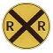
   - An intersection
   - A crosswalk
   - **✔ A railroad crossing**
   - A blasting zone

11. What vehicles must stop at all railroad crossings?
   - Pickup trucks
   - **✔ School buses and passenger buses carrying passengers**
   - Motorcycles
   - Vehicles towing a trailer

12. Night driving is dangerous because:
   - Some traffic signs are less visible at night
   - More vehicles are on the road at night
   - **✔ The distance we can see ahead is reduced**
   - Street lights tend to blur our vision

13. If a tire blows out, the proper thing to do is:
   - Speed up to gain traction and then pull to the right
   - **✔ Hold the steering wheel firmly, and ease up on the gas**
   - Apply the brakes, then shift into neutral
   - Shift into neutral, then apply the brakes

14. Which of the following statements applies to all driving emergency situations?
   - Always slow down gradually
   - Your first reaction is the best reaction
   - **✔ Think before you act**
   - Apply your brakes immediately

15. When you drive in heavy fog during daylight hours you should drive with your:
   - Headlights off
   - Parking lights on
   - **✔ Headlights on low beam**
   - Headlights on high beam

16. What is the appropriate action to take when approaching a railroad crossing that does not have signals (such as lights or crossing gates)?
   - Always bring the car to a complete stop
   - **✔ Slow down and be prepared to stop**
   - Do nothing; all railroad crosings have signals
   - Increase speed to get across the tracks quickly

17. When you get ready to leave an expressway, you should begin to use your turn signal:
   - Just as you get to the exit ramp
   - 50 feet before the exit ramp
   - **✔ 100 feet before the exit ramp**
   - When you see cars behind you in the exit lane

18. If traffic prevents you from crossing all the way across a set of railroad tracks, you may proceed only when:
   - An approaching train is not moving fast enough to be a danger
   - **✔ There is room for your vehicle on the other side**
   - At least one half of your vehicle can cross the tracks
   - No trains are in sight

19. Why is driving on an expressway different from driving on an ordinary street?
   - **✔ You must think faster and handle your vehicle more effectively**
   - Trucks have to go slower on the expressways
   - There is more of a tendency to exceed the speed limit
   - There is more of a tendency to "tailgate"

20. You are getting on a highway which has a very short entrance lane. The safest way for you to enter the flow of traffic would be to:
   - Use as much ramp as possible to get up to cruising speed
   - Use the left lane of the highway to get up to cruising speed
   - **✔ Wait for a large gap in traffic then speed up quickly**
   - Get up to cruising speed gradually so other cars will see you

21. You may drive around or under a gate that is being lowered or raised at a railroad crossing:
   - As long as an approaching train is not too close
   - If your vehicle can do so without damaging the gate
   - If you first look carefully in both directions
   - **✔ Under no circumstances**

22. If your brake pedal suddenly sinks to the floor, you should first:
   - **✔ Try to pump it to build up the pressure**
   - Shift into neutral and shut the engine off
   - Try to raise it by hooking your toe under it
   - Apply the parking brake hard to stop the car

## Chapter 11 - Sharing the Road

1. On a road which has no sidewalks a pedestrian should walk on the:
   - Side of the road which has the lightest traffic
   - Same side of the road in which traffic is moving
   - **✔ Side of the road facing oncoming traffic**
   - Side of the road which has the heaviest traffic

2. What does a "slow moving vehicle" emblem look like?
   - A square red sign
   - A round green sign
   - A diamon-shaped yellow sign
   - **✔ A triangular orange sign**

3. You want to back out of your driveway. You see children playing nearby. Before you start to move your car you should:
   - Race your motor to warn the children that you are moving
   - Sound your horn so the children will hear you
   - **✔ Walk to the back of the car to be sure the way is clear**
   - Tell the children to stay away from the driveway

4. Motorists should be aware that all bicycles used after dark must have:
   - Reflective handlebar grips
   - **✔ A front headlight and red taillight**
   - White reflectors on the front and rear fenders
   - Brake lights

5. A motorist should know that a bicyclist operating on a roadway must:
   - **✔ Ride on the right side of the road**
   - Ride on the side of the road facing traffic
   - Ride on either side of the road
   - Ride on the side of the road with the least traffic

6. A motorist approaching a bicyclist should:
   - Speed up to pass him
   - Proceed as usual
   - Swerve into the opposite lane
   - **✔ Exercise extreme caution**

7. A blind person legally has the right-of-way when crossing the street when:
   - Wearing light-colored clothing
   - **✔ Led by a guide dog, or using a white or metallic cane**
   - Helped by another person
   - Wearing dark-colored glasses

8. A bicyclist differs from a motorist in that a bicyclist isn't required to:
   - Obey the same traffic laws
   - Signal all turns
   - Report accidents resulting in serious injury
   - **✔ Insure the bicycle**

## Road Signs You Need To Know

1. This (no left turn) sign means: 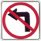
   - All traffic turn left
   - **✔ No left turn**
   - No U-turn
   - Truck route to the left

2. This sign (school crossing) means: 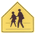
   - Pedestrians only
   - Intersection ahead
   - Hiking trails ahead
   - **✔ School crossing ahead**

3. This sign (merging traffic from right) means: 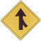
   - One-way traffic
   - Intersection ahead
   - **✔ Merging traffic from the right**
   - Highway curves ahead

4. This sign (hill ahead) means: 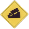
   - Trucks under 18,000 lbs. allowed
   - **✔ Hill ahead**
   - Truck stop ahead
   - No trucks allowed

5. This sign (traffic light ahead) means: 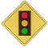
   - Continue at your current speed
   - You must stop ahead
   - Speeding is not allowed
   - **✔ There is a traffic signal ahead**

6. This sign (slippery when wet) means: 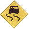
   - Don't drink if you are going to drive
   - **✔ Slippery when wet**
   - Road curves ahead
   - You are approaching a hill

7. This sign (do not enter) is used to prevent: 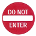
   - Entrance to full parking lots
   - Entrance to road construction areas
   - Entrance to dead-end streets
   - **✔ Wrong-way entrance on one-way streets and expressway ramps**

8. This sign (stop sign) means: 
   - Slow down and prepare to stop only if cars are approaching you
   - **✔ Come to a full stop, then go when it is safe to do so**
   - Proceed carefully through the intersection, not always stopping
   - Stop only for traffic on an intersecting road

9. This sign (yield sign) means: 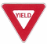
   - Slow down if an emergency vehicle is approaching
   - Look both ways as you cross the intersection
   - Always come to a full stop at the intersection
   - **✔ Slow down and be prepared to stop if necessary**

10. This sign (two way traffic) means: 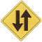
   - Four-lane traffic ahead
   - Divided highway ahead
   - **✔ Two-way traffic ahead**
   - Intersection ahead

11. This sign (hospital to right) means: 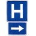
   - Highway changes ahead to the right
   - Hiking trails ahead to the right
   - Hotel ahead to the right
   - **✔ Hospital ahead to the right**

12. This sign (right lane ends keep left) means: 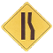
   - Merging traffic is approaching from the right
   - Winding road ahead
   - **✔ Right lane ends, stay to the left**
   - Divided highway ahead

13. This sign (keep right) means: 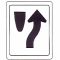
   - Divided highway ends
   - One-way traffic ahead
   - Two-way traffic ahead
   - **✔ Keep to the right**

14. This sign (railroad crossing) is a warning that you are approaching: 
   - An intersection
   - A crosswalk
   - **✔ A railroad crossing**
   - A blasting zone

15. This sign (no u turn) means: 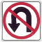
   - No left turn
   - No stopping
   - **✔ No U-turn**
   - Detour ahead

16. This sign (divided highway ends) means: 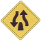
   - Divided highway ahead
   - One-way taffic ahead
   - Four-lane highway ahead
   - **✔ Divided highway ends**
